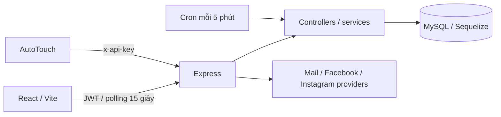

# Audit kiến trúc — 2026-10-11

Phạm vi: mã nguồn local, schema MySQL local (chỉ đọc metadata), API/SQL trên database tạm, browser Chrome headless. Không đăng nhập VPS, không sửa database đang dùng, không gọi seed, không tạo tải bên thứ ba.

- Startup: `backend/src/server.js`, đăng ký model, sync không force/alter, nhiều migration SQL khi khởi động, cron và HTTP server. Không thể coi startup là thao tác chỉ đọc.
- API mount: `backend/src/routes/index.js`; TOTP/mail có parser/log riêng trong app.js.
- Dispatcher: khóa user_dispatcher_state → device → task/source; adapter gọi controller nghiệp vụ trong transaction. Cursor lưu MySQL, không nằm trong bộ nhớ.
- Domain account/claim/page có khóa riêng; DeviceTaskRun ghi thực thi. Report task chỉ ghi kết thúc execution, không thay báo cáo nghiệp vụ cũ.
- Realtime là REST polling. Redis, broker queue, WebSocket và worker queue riêng không được cấu hình; kiểm thử tương ứng N/A.
- PM2 khai báo cluster. Cron trước audit chỉ có biến running theo tiến trình; đã thêm MySQL session advisory lock để ngăn các worker cùng thực thi.
- Cài đặt → System Health dùng JWT; thiết bị/task theo owner, thông tin cron/API chung chỉ admin thấy. Cron snapshot lưu AppSetting để các worker đọc cùng dữ liệu. API latency/error window vẫn theo từng worker, không phải tổng cluster.
- Inventory đầy đủ: `backend/tests/audit/source-inventory.json`. Đếm file/route tự động không có nghĩa mọi nhánh đều đã được kiểm thử.

Giới hạn: chưa xác minh container production, proxy/port thực tế, tài nguyên VPS, migration toàn bộ startup trên bản sao production, tất cả CRUD từng trang, soak test 24/7 hay mọi nhánh lỗi external provider. Xem TEST_MATRIX.md; không xác nhận nghiệm thu toàn hệ thống.
